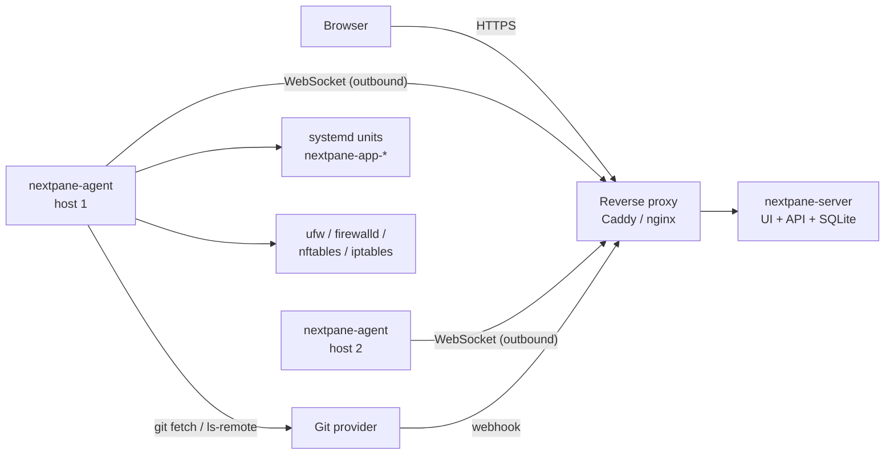

<p align="center">
  
</p>

<h1 align="center">NextPane</h1>

<p align="center">
  A self-hosted, Vercel-like panel for the Node.js sites running on your own servers.<br>
  One small Rust agent per host, one panel to deploy, limit, monitor and secure every app.
</p>

---

NextPane is deliberately small. It is not a PaaS and not a Coolify: no containers, no build farm, no
marketplace. It turns a plain Linux server into a place where `git push` deploys your Node.js app, and
gives you a black, quiet dashboard to see what each app costs the host.

## Features

| | |
|---|---|
| **Git deployments** | Link an app to any Git repository (GitHub, GitLab, Gitea, Forgejo, Bitbucket, your own). Public or private (per-app SSH deploy key generated on the host). |
| **Auto-deploy** | New commits are picked up by polling (works everywhere, even behind NAT) or instantly with a deploy webhook. |
| **Zero-config builds** | npm, pnpm, yarn and bun detected from the lockfile. Install, build and start commands can be overridden. |
| **Resource limits** | CPU and memory limits per app, enforced by systemd/cgroups, also applied during builds. |
| **Monitoring** | Host CPU, memory, disk, network and load, with what the **apps** use separated from what the **system** uses. Per-app CPU, memory and disk size. |
| **Environment variables** | Encrypted at rest, editable in the UI, bulk import from `.env`, export protected by password re-entry and optionally encrypted (OpenSSL-compatible). |
| **SSH keys** | Manage `authorized_keys` of the dedicated `nextpane` user on each host. |
| **Firewall** | Per-app inbound rules on **ufw, firewalld, nftables or iptables**, auto-detected, cleaned up with the app. |
| **Cache** | One-click cache clear (e.g. `.next/cache`) followed by a restart. |
| **Updates from the UI** | Update the server (deb/rpm/binary) and every agent from the web UI, checksum-verified. |
| **Packaging** | Server: Docker image, `.deb`, `.rpm`. Agent: `.deb`, `.rpm`, static binary, one-line installer, **Ansible role**. |

## How it works



- The **agent** is a ~2 MB static Rust binary. It opens **one outbound WebSocket** to the panel (no
  inbound port on the host), reports metrics every 10 s (≈ 0.5 KB per report) and executes commands.
- Every app is a hardened **systemd service** running as the unprivileged `nextpane` user, with its
  own cgroup: this is where limits and per-app metrics come from.
- The **server** is a single Rust binary with the web UI embedded, storing its state in SQLite.

## Quick start

**1. Run the panel** (Docker, with automatic HTTPS through Caddy):

```sh
git clone https://github.com/midnights-ra1n/NextPane && cd NextPane
PANEL_DOMAIN=panel.example.com docker compose up -d
docker compose logs nextpane | grep "setup code"
```

Open `https://panel.example.com`, enter the setup code and create the admin account.
Debian/Ubuntu/RHEL packages are described in [Installation](docs/installation.md).

**2. Add a host.** *Hosts › Add host* creates an enrollment key and gives you the command to run on the server:

```sh
curl -fsSL https://panel.example.com/install.sh | sudo NEXTPANE_SERVER=wss://panel.example.com/agent/ws NEXTPANE_TOKEN=npk_… sh
```

Many hosts at once? Use the [Ansible role](docs/ansible.md).

**3. Deploy an app.** Make sure Node.js is installed on the host, open it in the panel, click
*New app*, paste the repository URL, then *Deploy*.

## Documentation

| Guide | |
|---|---|
| [Installation](docs/installation.md) | Server (Docker, deb, rpm), reverse proxy, agent install and uninstall |
| [Configuration](docs/configuration.md) | Every setting and file location |
| [Apps & deployments](docs/apps.md) | Git, builds, private repos, auto-deploy, webhooks, env vars, limits, cache, logs |
| [Monitoring](docs/monitoring.md) | What each metric means, host vs. apps |
| [Firewall](docs/firewall.md) | Per-app rules on ufw, firewalld, nftables, iptables |
| [Updates](docs/updates.md) | Updating the server and agents from the UI, publishing releases |
| [Ansible](docs/ansible.md) | Mass deployment, upgrades and removal of agents |
| [Security](docs/security.md) | Threat model, secrets, hardening |
| [Architecture & protocol](docs/architecture.md) | Components and the agent WebSocket protocol |
| [Development](docs/development.md) | Building, testing, releasing |

## Requirements

- **Server:** any Linux (or Docker). 64 MB RAM is plenty.
- **Hosts:** Linux with systemd and cgroup v2 (Debian 11+, Ubuntu 22.04+, RHEL/Alma/Rocky 9+), `git`,
  `curl`, and Node.js (plus pnpm/yarn/bun if your apps use them). x86_64 or aarch64.

## License

MIT. Geist and Geist Mono fonts © Vercel, under the SIL Open Font License (`web/fonts/OFL.txt`).
