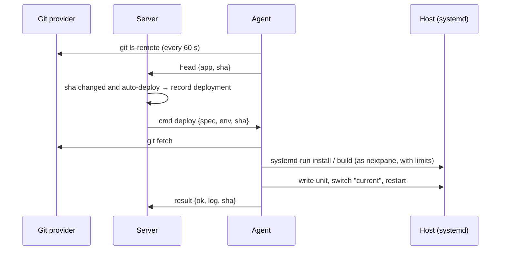

# Architecture & protocol

```
crates/
  proto/    shared message types and validation (used by both sides)
  agent/    nextpane-agent: WebSocket client, metrics, apps, firewall, self-update
  server/   nextpane-server: axum HTTP API, agent hub, SQLite, self-update
web/        the UI (vanilla JS + CSS, embedded in the server binary at build time)
packaging/  systemd units, deb/rpm scripts, installer, Dockerfiles
ansible/    nextpane_agent role and playbooks
```

## Server

- **axum** HTTP server serving the API (`/api/*`), the embedded UI, `/install.sh`, webhooks
  (`/hooks/<app>/<secret>`) and the agent endpoint (`/agent/ws`).
- **SQLite** (WAL) for users, sessions, enrollment keys, hosts, apps (settings as JSON), encrypted env
  vars, SSH keys, deployments with logs, audit log.
- In memory: connected agents, last hour of metrics per host, pending command round-trips.

## Agent

- Single-threaded tokio runtime; blocking work (git, builds, systemctl, firewall tools) runs on a
  blocking thread pool so metrics keep flowing during a deploy.
- Reconnects with exponential backoff (2 s → 60 s). Pings every 30 s; a link silent for 90 s is
  considered dead on both sides.
- One mutating operation per app at a time.
- Typical footprint: ~2 MB binary, a few MB of RAM, negligible CPU between reports.

## Protocol

One WebSocket, JSON text frames, `t` field as discriminator.

### Connection

```
GET /agent/ws
X-Machine-Id: <contents of /etc/machine-id>
Authorization: Bearer npk_…        (first connection only)
X-Host-Secret: <secret>            (after enrollment)
```

### Agent → server

| `t` | Payload | When |
|---|---|---|
| `hello` | version, hostname, os, kernel, arch, cpus, mem_total, firewall backend, install method | First frame |
| `metrics` | host cpu/load/mem/swap/disk/net/uptime + per-app cpu/mem/disk/running | Every `metrics_interval` |
| `head` | `{app, sha}` | Every `poll_interval`, for auto-deploy apps |
| `result` | `{id, ok, output, data}` | Answer to a `cmd` |

### Server → agent

| `t` | Payload |
|---|---|
| `welcome` | `{host_secret}`, first enrollment only |
| `sync` | Desired state: every app spec, SSH keys, intervals. Sent after each connection and after changes. |
| `cmd` | `{id, cmd}` where `cmd.kind` is one of: `deploy`, `configure`, `action` (start/stop/restart), `remove`, `clear_cache`, `logs`, `deploy_key`, `ssh_keys`, `self_update` |

Example:

```json
{"t":"cmd","id":42,"cmd":{"kind":"deploy","app":{"name":"web","repo":"git@github.com:me/web.git","branch":"main","port":3000,"memory_mb":512,"cache_paths":[".next/cache"],"auto_deploy":true,"firewall":[]},"env":[{"key":"DATABASE_URL","value":"…"}],"sha":null}}
{"t":"result","id":42,"ok":true,"output":"…build log…","data":"3f9c2e…"}
```

### Bandwidth

Only three things flow regularly: a ~0.3–1 KB `metrics` frame every 10 s, a tiny `head` frame per
auto-deploy app every 60 s and a ping every 30 s. Commands and logs are sent on demand. Git traffic
goes directly from the host to the Git provider, never through the panel.

## Deployment sequence


